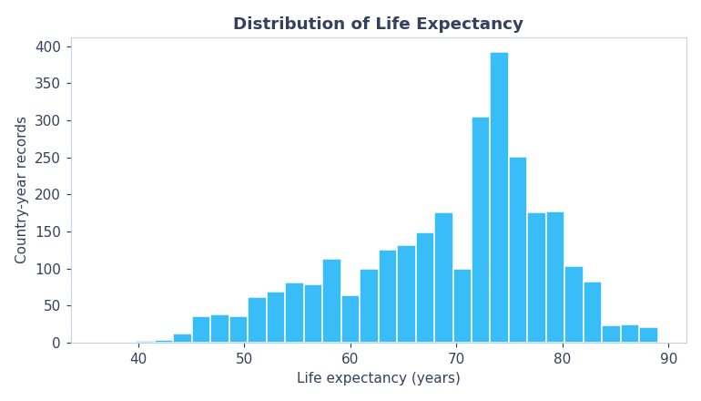
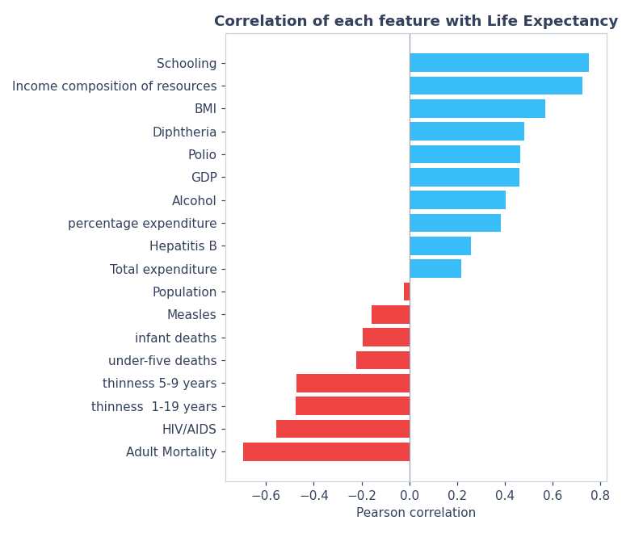
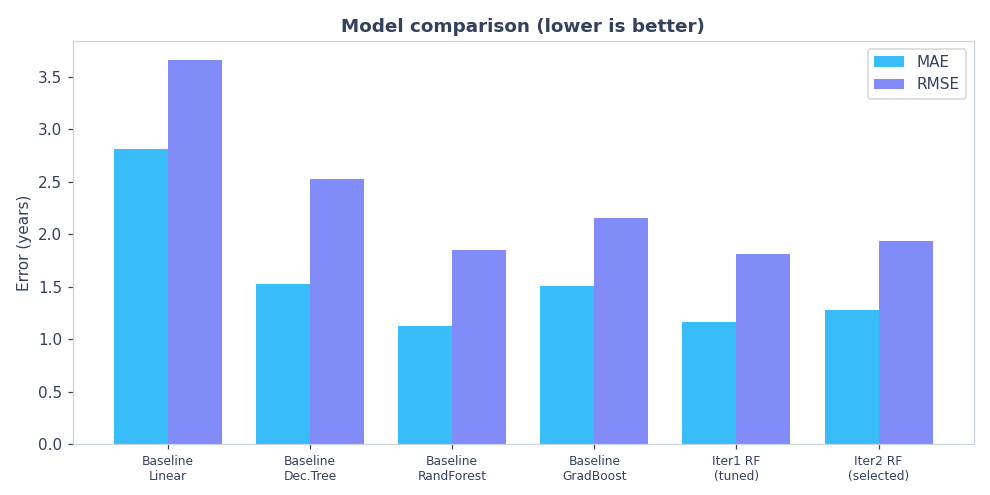
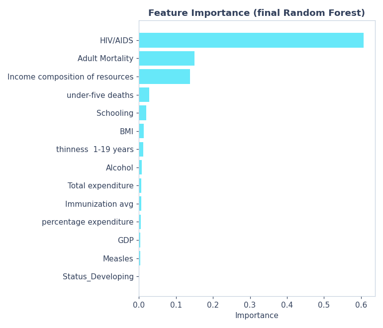

# Life Expectancy Prediction

**Machine Learning for Developers (CAI2C08) — Individual Project**
Predicting a country's **life expectancy (in years)** from its health, economic and social indicators, using scikit-learn, and deploying the model as an interactive Streamlit web app.

---

## 1. Problem Statement

Health ministries, NGOs and global-health planners need to understand **what drives life expectancy** and to **estimate it** for a country from measurable indicators, so they can decide where to invest limited resources (education, immunisation, health spending, disease control).

This project frames that need as a **supervised regression problem**:

> Given a country's health, economic and social indicators for a year, predict its **life expectancy in years**.

The target (`Life expectancy`) is a continuous number, which is why this is **regression** (predicting a value) rather than classification (predicting a category). The business value is twofold: an **explanatory** view (which factors matter most) and a **predictive** tool (estimate life expectancy for a new profile), delivered through a web app a non-technical stakeholder can use.

---

## 2. The Data

**Source:** [Life Expectancy (WHO) — Kaggle](https://www.kaggle.com/datasets/kumarajarshi/life-expectancy-who) — a compilation of real World Health Organization and United Nations data.

| Property | Value |
|---|---|
| Records | 2,938 (country-year rows) |
| Countries | 193 |
| Years | 2000–2015 |
| Columns | 22 (1 target, 21 candidate features) |
| Target | `Life expectancy` (years, 36.3 – 89.0) |
| Task | Regression |

The data is **real, not synthetically generated**, which is a hard requirement of the brief (see Section 8 for the dataset that was rejected for failing this).

### Distribution of the target



Life expectancy is **left-skewed**: most country-years sit in the 70–75 year range, with a tail of lower values from countries affected by conflict, poverty or high disease burden.

---

## 3. What Shaped the Data (Cleaning & Preparation)

The dataset is real, so it is **messy** — and dealing with that mess is where most of the modelling decisions were made.

**Missing values.** Several columns have substantial gaps:

| Column | Missing | Handling |
|---|---|---|
| Population | 652 | dropped (also ~0 correlation) |
| Hepatitis B | 553 | dropped (redundant with other vaccines) |
| GDP | 448 | imputed (median) |
| Total expenditure | 226 | imputed (median) |
| Alcohol | 194 | imputed (median) |
| Income composition | 167 | imputed (median) |
| Schooling | 163 | imputed (median) |
| Life expectancy (target) | 10 | **rows dropped** (never impute the target) |

**Column-name whitespace.** The raw headers contain stray spaces (e.g. `" Life expectancy "`), which are stripped with `df.columns.str.strip()` — without this, referencing `df['Life expectancy']` raises a `KeyError`.

**Encoding.** The only categorical feature, `Status` (Developing / Developed), is one-hot encoded with `pd.get_dummies(drop_first=True)`, producing a single `Status_Developing` column.

**Two competing strategies for missing data** — and this became the core "iteration" of the project:

- **Baseline:** drop every row with any missing value → **1,649 rows**.
- **Iteration 1:** impute missing feature values with the column median → **2,928 rows** (≈1,300 more).

### How the features relate to the target



The correlations make real-world sense and confirm the data has genuine signal:

| Strong positive | r | Strong negative | r |
|---|---|---|---|
| Schooling | +0.75 | Adult Mortality | −0.70 |
| Income composition | +0.72 | HIV/AIDS | −0.56 |
| BMI | +0.57 | thinness 1-19 years | −0.48 |
| Diphtheria / Polio | +0.48 / +0.47 | under-five deaths | −0.22 |
| GDP | +0.46 | Measles | −0.16 |

Education, income and immunisation raise life expectancy; mortality, HIV/AIDS and malnutrition lower it.

---

## 4. How It Was Built — The Process

The project follows the **CRISP-DM** workflow, mirrored in the notebook structure:

1. **Business Understanding** — define the problem as regression.
2. **Data Understanding** — load, inspect types, count missing values, describe, and visualise (target distribution, feature distributions, correlation heatmap).
3. **Data Preparation** — clean, encode, split (70 % train / 30 % test, `random_state = 2026`).
4. **Modelling** — train four models, then tune the best.
5. **Model Evaluation** — compare with error metrics, justify the choice.
6. **Iterative Model Development** — improve the model in cycles, each tested as a hypothesis.

Everything uses **scikit-learn only** for the models (as required), plus pandas / numpy / matplotlib / seaborn for data handling and visualisation, and joblib to save the model.

### Choice of evaluation metric

Because this is regression, the models are judged on **error metrics in the same unit as the target (years)**:

- **MAE (Mean Absolute Error)** — the headline metric. "On average the prediction is off by X years" — easy for a stakeholder to understand.
- **RMSE (Root Mean Squared Error)** — supporting metric; squares errors so it penalises large mistakes more.
- **MSE** — reported for completeness.

**R² was deliberately not used.** It is a relative score rather than an error in the target's unit, it can be inflated simply by adding features, and a high R² can hide large individual errors. MAE and RMSE give a more honest picture of how many years off the model is.

---

## 5. The Models & Why Random Forest

Four regression models were trained on the basic features and compared:



| Model | MAE | RMSE | Verdict |
|---|---|---|---|
| Linear Regression | 2.812 | 3.656 | Weakest — assumes linear relationships |
| Decision Tree | 1.523 | 2.525 | Overfits a single tree |
| **Random Forest** | **1.128** | **1.848** | **Best — chosen** |
| Gradient Boosting | 1.503 | 2.155 | Good, but behind RF here |

**Why Random Forest and not the others:**

- **vs Linear Regression** — life expectancy does not vary linearly with skewed features like GDP and HIV/AIDS, so a linear model underfits badly (MAE more than double RF's).
- **vs a single Decision Tree** — one tree memorises the training data and generalises poorly; a *forest* averages many trees and is far more stable.
- **vs Gradient Boosting** — competitive, but on this dataset Random Forest gave lower error out of the box and was less sensitive to settings.

Random Forest also brings two practical advantages that suited this data: it is **invariant to feature scale** (so GDP in the thousands and Schooling in single digits need no standardisation), and it is **robust to skew and outliers** because it splits on thresholds rather than distances.

---

## 6. Hyperparameter Tuning

Per the brief, tuning uses **`RandomizedSearchCV` only**, with **no more than 3 values per hyperparameter**:

```python
param_dist_rfr = {
    'n_estimators':      [50, 100, 150],
    'max_depth':         [10, 20, 30],
    'min_samples_split': [2, 5, 10]
}
```

Settings: `n_iter = 6`, `cv = 3`, `scoring = 'neg_mean_absolute_error'`. Each search therefore trains **6 × 3 = 18 models**, plus a final refit — and tuning is run **in every cycle** (baseline, Iteration 1, Iteration 2) so comparisons are fair.

**Best parameters found (consistently):** `n_estimators = 100`, `max_depth = 20`, `min_samples_split = 2`.

A key finding: **tuning barely changed the baseline** (MAE 1.128 → 1.126). This was informative — it showed the model was already near its ceiling for the given features, so the real gains would have to come from **improving the data**, not the settings. That insight is what motivated the iterations.

---

## 7. The Iterations / Cycles In Detail

The model was improved in cycles, each framed as a **hypothesis**: make one change, retrain, compare, and keep it only if it helps.

### Cycle 1 — Baseline
Drop only `Country`, drop rows with any missing value, train four models, tune the best.
**Result:** Random Forest, **MAE 1.13 / RMSE 1.85** on 1,649 rows. This is the benchmark.

### Iteration 1 — Imputation + Feature Engineering
The most valuable step.
- **Imputation instead of dropping** — missing feature values are filled with the column median rather than deleting the whole row, recovering ~1,300 rows (**1,649 → 2,928**).
- **Feature engineering** — `Immunization avg = (Polio + Diphtheria) / 2`, combining two correlated vaccine columns into one clean "immunisation coverage" feature.
- **Redundancy removal** — dropped `infant deaths` (near-duplicate of `under-five deaths`) and `thinness 5-9 years` (near-duplicate of `thinness 1-19 years`).

**Result:** **MAE 1.16 / RMSE 1.81**. Even though the test set is now larger and harder, RMSE falls slightly, and — most importantly — the model learns from far more of the world's countries, making it more robust.

### Iteration 2 — Feature Importance + Selection



Feature importance shows the prediction is dominated by a handful of features. Keeping only those that make up **90 % of total importance** leaves just **4 features**: `HIV/AIDS`, `Adult Mortality`, `Income composition of resources`, `under-five deaths`.
**Result:** **MAE 1.28 / RMSE 1.93** — tested on the *same rows* as Iteration 1, so this is a fair, direct comparison. It is **worse** than the full model, which proves the remaining features still add value.

### Summary of every model

| Stage | Rows | MAE | RMSE |
|---|---|---|---|
| Baseline – Linear Regression | 1,649 | 2.812 | 3.656 |
| Baseline – Decision Tree | 1,649 | 1.523 | 2.525 |
| Baseline – Random Forest | 1,649 | 1.128 | 1.848 |
| Baseline – Gradient Boosting | 1,649 | 1.503 | 2.155 |
| Baseline – Random Forest (tuned) | 1,649 | 1.126 | 1.850 |
| Iteration 1 – Random Forest (tuned) | 2,928 | **1.160** | **1.811** ← final |
| Iteration 2 – Random Forest (selected, tuned) | 2,928 | 1.281 | 1.934 |

**Final model:** Iteration 1's tuned Random Forest (all 14 engineered features), saved for the app.

---

## 8. What Was Tried That Failed — and Why

Being honest about the dead ends is part of the process, and each one taught something.

**A synthetic dataset (rejected before it began).** The first dataset explored was a "healthcare patient analytics" file. EDA exposed it as **synthetic**: every numeric feature had ~0 correlation with the target, the timestamps were perfectly hourly and sequential, and categories were suspiciously uniform. A model on it could not beat predicting the mean. Because the brief forbids synthetic data, it was abandoned — a lesson in **always validating that data has real signal before modelling.**

**A diabetes length-of-stay dataset (considered, set aside).** A real UCI hospital dataset was a strong candidate, but it was too close to a classification lab already completed, so a more distinctive regression problem (life expectancy) was chosen.

**Removing outliers (tested, rejected).** A hypothesis that the extreme `GDP` and `HIV/AIDS` values were harming the model was tested with the IQR rule. It **deleted ~650 valid rows and made the model worse** — the "outliers" were genuine countries (very wealthy nations, high-HIV nations), not errors. The change was rejected and the outliers kept. Lesson: **not every anomaly is an error.**

**Feature selection to 90 % importance (tested, rejected).** Iteration 2 showed a 4-feature model does not beat the full 14-feature model, so the smaller features were retained.

**What was learnt overall:**
- Data quality matters more than model tuning — the biggest gain came from *keeping more data* via imputation, not from hyperparameters.
- Metrics must be compared fairly — changing the row count makes MAE/RMSE non-comparable across those stages, which is why the fair comparisons were done on fixed row sets.
- A simple, well-understood model (Random Forest) with good data beats a fancier model with poor data.

---

## 9. The Web App

The model is deployed with **Streamlit** so a non-technical user can get a prediction without touching code. Two versions were built:

**Version A — lab-style app.** A straightforward form: inputs, a *Predict* button, `get_dummies` + `reindex(model.feature_names_in_)`, and a result. Simple and reliable.

**Version B — custom dashboard (final).** A restyled, unique interface:
- Deep-navy gradient theme with custom Google fonts and a glowing result card.
- All inputs in a **sidebar**; the Streamlit top bar / Deploy button hidden via CSS.
- Live **data graphs** (feature importance, target distribution, schooling-vs-life-expectancy) drawn from the training data.
- A **saved-scenarios table** with a **Download CSV** button, so a user can test several country profiles and export them.

**Benefits of Version B over A:** it looks distinct and professional (not a template clone), it *teaches* the user via the graphs, and the scenario export makes it genuinely useful rather than a one-off calculator. The trade-off is more code and a small extra dependency (matplotlib). Version B is the one shipped.

The app loads a single artifact, `life_expectancy_model.pkl`, and reads the feature order directly from `model.feature_names_in_`, so no separate feature-list file is needed.

---

## 10. Notebook Structure

The notebook mirrors CRISP-DM and is fully reproducible (Restart → Run All):

```
Declaration of Originality
Libraries
Setup (shared settings + reusable evaluate function)
1. Business Understanding
2. Data Understanding      (load, info, missing-value check, describe, EDA plots)
3. Data Preparation        (3.1 Cleaning, Feature Dictionary, 3.2 Train-Test Split)
4. Modelling               (4.1 Train Model, 4.2 Hyperparameter Tuning)
5. Model Evaluation        (metric justification, baseline observation, unseen-data demo)
Iterative model development (Iteration 1, Iteration 2, Summary, Overall Summary)
Conclusion
Save final model
```

Each cycle **reloads the raw data and redoes its own cleaning**, so every stage is self-contained and can be re-run independently without state bugs. A reusable `evaluate()` function keeps metric reporting consistent and collects every result into a final summary table.

---

## 11. Limitations

**Of the data / model:**
- **Aggregate data.** Rows are country-year averages, so the model predicts national life expectancy, not an individual's.
- **Bounded target & era.** Data covers 2000–2015; predictions for very different years or unusual countries are extrapolation.
- **Imputation introduces assumptions.** Median-filling missing values keeps more data but assumes those countries are "typical" for that feature.
- **Correlation ≠ causation.** Some positive signs (e.g. alcohol, BMI) reflect national wealth, not a causal benefit; the model should not be read as policy advice on those.
- **Marginal iteration gains.** The dataset is "easy" enough that Random Forest is near its ceiling early, so improvements are small — the value is in robustness and process, not a dramatic score jump.

**Of building / running the notebook:**
- Column names contain stray whitespace that must be stripped first, or lookups fail.
- Notebook cells share memory, so cells must be run **in order** (Restart → Run All) — re-running a cleaning cell out of order caused `KeyError`/state bugs during development.
- `RandomizedSearchCV` in three cycles makes a full run take a couple of minutes.
- Cross-stage metric comparison is not straightforward when imputation changes the row count — this had to be handled carefully rather than comparing numbers blindly.

---

## 12. Repository Contents

| File | Purpose |
|---|---|
| `MLDP Program Codes Submission Template.ipynb` | Full notebook (EDA → modelling → iterations) |
| `app.py` | Streamlit web app |
| `life_expectancy_model.pkl` | Saved final Random Forest model |
| `Life Expectancy Data.csv` | Dataset |
| `requirements.txt` | App dependencies |
| `images/` | Charts used in this README |

**Run the app locally:**
```bash
pip install -r requirements.txt
streamlit run app.py
```

---

## 13. Results at a Glance

- **Final model:** tuned Random Forest, 14 engineered features.
- **Accuracy:** **MAE ≈ 1.16 years**, **RMSE ≈ 1.81 years** on held-out test data.
- **Interpretation:** for a target spanning roughly 40–90 years, being off by about one year is a strong, business-usable result.
- **Top drivers:** Income composition, HIV/AIDS, Adult Mortality, Schooling.
- **Biggest lesson:** imputing missing data (keeping ~1,300 more rows) mattered more than any hyperparameter.
